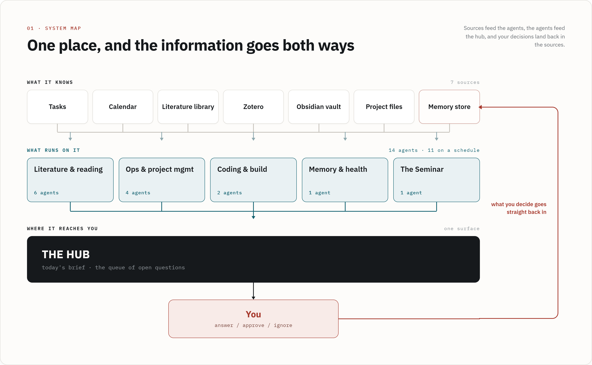
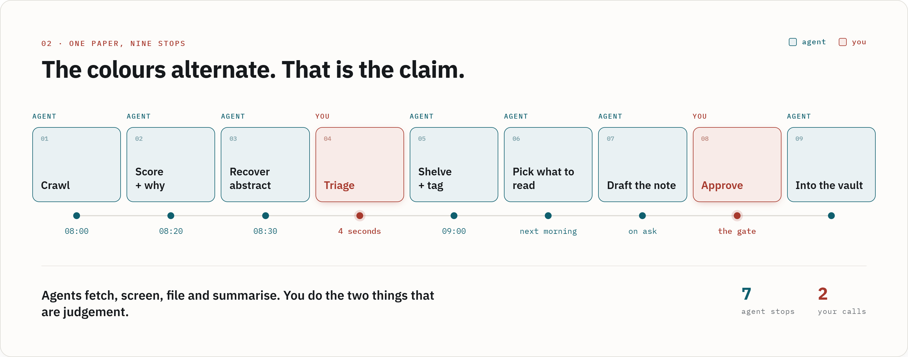

# How Nico's research hub works

This is the setup behind the 13:15 demo, written for people rather than
for an agent. To see it rather than read about it, open
`hub-tour/index.html`, a copy of the dashboard filled with placeholder
data. To build your own version, follow the steps in this folder's
`README.md`: your agent interviews you and builds the first small piece
with you.

**Read this as a map of where it ended up, not as a plan.** The full hub
took months, and nobody designed it up front. It grew out of one small
loop, described under "Version one" below. That loop is the part worth
copying.

## The big picture: one place, information going both ways

The hub has three layers.

1. **What it knows.** Sources I already had before any agent was involved:
   my task list, calendar, literature library, Zotero, my Obsidian notes,
   project files, and a memory store. None of these are special software.
   Most are plain files or apps with an API.
2. **What runs on it.** Around fourteen small agents. Each one is a written
   instruction file with one job, for example "score new papers for
   relevance", "check whether any project has lost its next step", or
   "draft a literature note". Eleven run on a schedule overnight on a small
   always-on computer. The rest run when I ask.
3. **Where it reaches me.** One surface: a morning brief plus a queue of
   open questions the agents could not settle themselves. I answer, approve
   or ignore each one.

**What makes it a hub and not a dashboard is that my decisions go back
in.** When I answer a question, approve a draft or thumbs-down a paper,
that is written back into the sources, so the next run already knows it.
Without that return path, the brief is just a nicer view of the same
information.

## Version one: five steps

Before any of the rest existed, the whole thing was a literature loop:

1. **Pull a keyword list out of what I already cite.** Read my own library
   once and extract the topics.
2. **Find the databases that have an API:** OpenAlex, arXiv and Semantic
   Scholar.
3. **Fetch and rank.** Get everything that matches, sort it roughly, and put
   it in front of me.
4. **Thumbs up, thumbs down.** One judgement per paper and nothing else.
5. **Let the votes rewrite the keywords,** so the next search is different.

Step 5 is the one that matters. It turns a saved search into a loop that
learns.

**What went wrong with it, and why it shaped everything after.** My first
step 5 learned *negative* keywords from the titles of papers I downvoted.
Disliking a single simulation paper was enough to put "simulation" and
"replication" on the blocklist, while I was writing a paper on synthetic
replication. By the time I noticed, 19 of the 43 learned negative terms
were core topics of my own thesis. The problem was not the automation
itself. Nothing had written down *why* each term was added, so a silent,
compounding mistake had no place where I could see it.

Version two therefore took the judgement out of the keyword arithmetic.
It gave the judgement to an agent that **writes down its reasoning** for
every score. That written reasoning is the only reason I trust it.

## One paper, nine stops

This is where the literature loop is today, followed through a single
paper:

| # | Stop | Who | What happens |
|---|---|---|---|
| 1 | Crawl | agent | New papers are fetched from the open databases overnight |
| 2 | Score + why | agent | Each paper gets a relevance score and a one-line reason |
| 3 | Recover abstract | agent | Missing abstracts are found from other sources, verbatim, never paraphrased |
| 4 | **Triage** | **me** | Thumbs up or down, about four seconds per paper |
| 5 | Shelve + tag | agent | Kept papers are filed into collections and tagged in Zotero |
| 6 | Pick what to read | agent | About five papers to actually read, each with a reason why now |
| 7 | Draft the note | agent | A literature-note draft: summary, method, results, my highlights |
| 8 | **Approve** | **me** | The draft reaches my notes only if I approve it |
| 9 | Into the vault | agent | The approved note is written into Obsidian |

Agents fetch, screen, file and summarise. I make the two judgement calls.

## Principles

None of these needs the full system. They apply from day one.

- **Write the prompt down instead of retyping it.** Anything you ask for
  every week belongs in a file, as a skill, a command or project
  instructions. That was the only step I took on purpose; the rest
  followed.
- **Make the agent write down why.** Scores, decisions and changes should
  come with a reason you can read. Silent logic is where mistakes compound.
- **Gate by the cost of being wrong, not by "do I trust it?"** My agents may
  write to the memory store without asking, because it is append-only,
  timestamped and in git, so every write can be undone. They may not touch
  my own notes without approval. I would not notice an edit there, and
  prose is hard to diff.
- **Each kind of thing has one home.** Tasks live in the task list, notes in
  the vault, files in the project folder. Agents read from those homes
  rather than keeping private copies, so nothing drifts apart.
- **Chat history is not memory.** Anything that should survive the session
  goes into a file.
- **Verify, don't promise.** Have the agent audit its own output, then give
  that audit to a fresh subagent that has not seen the conversation.

## What it is built from

Nothing here is exotic. All of it is covered in the workshop repository.

- **Claude Code**, working in a project folder with a `CLAUDE.md` that
  explains the folder to the agent.
- **Skills and commands**, which are Markdown files holding the prompts I use
  often, such as `/daily-brief` and `/weekly-review`.
- **Subagents**, which are Markdown files, each describing one agent with
  one job.
- **MCP connections** to the tools I already use: Zotero, the task list, the
  literature database and the calendar.
- **A scheduler** that runs some of the agents overnight. This is the only
  part that needed an always-on machine. **You do not need it to start.**

## Where you would start

Pick **one** of these, not both.

1. **The hub, if your problem is organisation.** Put your tasks somewhere an
   agent can read them (one Markdown file is enough). Write one skill,
   `/brief`, that reads the file and tells you what today looks like. Run
   it every morning. The real gain is not the automation: you stop deciding
   all over again every morning what matters today.
2. **Literature, if your problem is the pile of papers.** Connect your
   Zotero library and ask the agent which themes you actually work on. That
   is worth an afternoon on its own, because they are rarely the themes you
   would have written down. Then write a scout that searches **one** open
   database (OpenAlex needs no API key) and shows you matches when you ask.

Neither is a project. Each one is an afternoon, and neither needs a
Raspberry Pi. This folder's `README.md` shows how to start either one
with your own agent.

Questions: Nico Mutzner, nico.mutzner@uzh.ch
